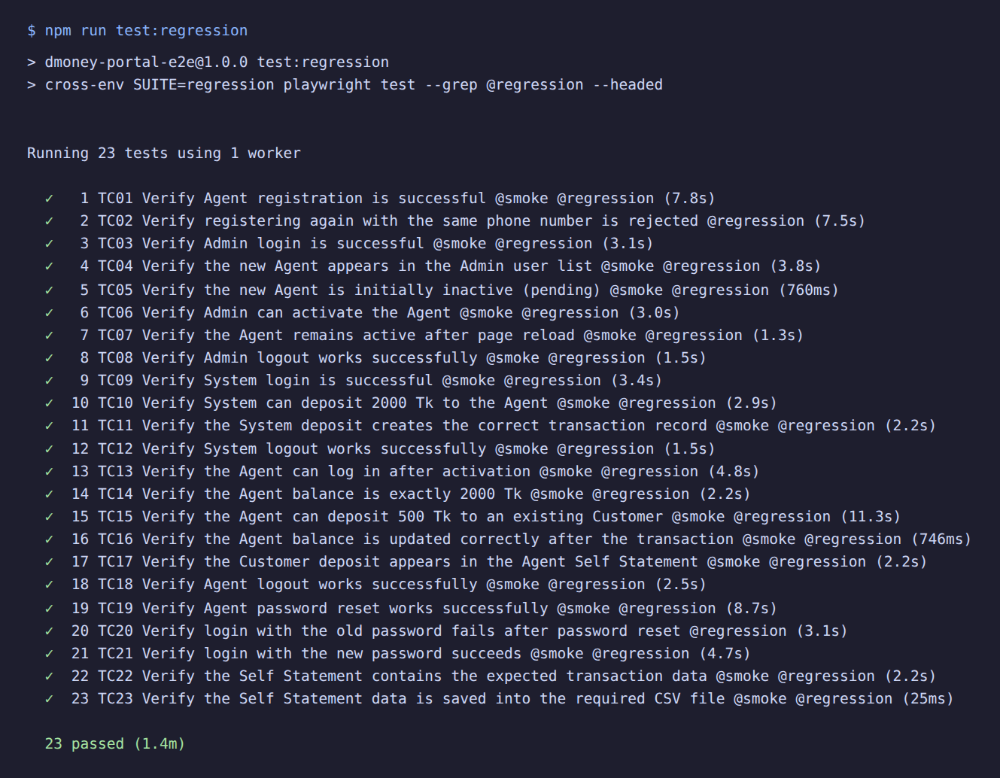
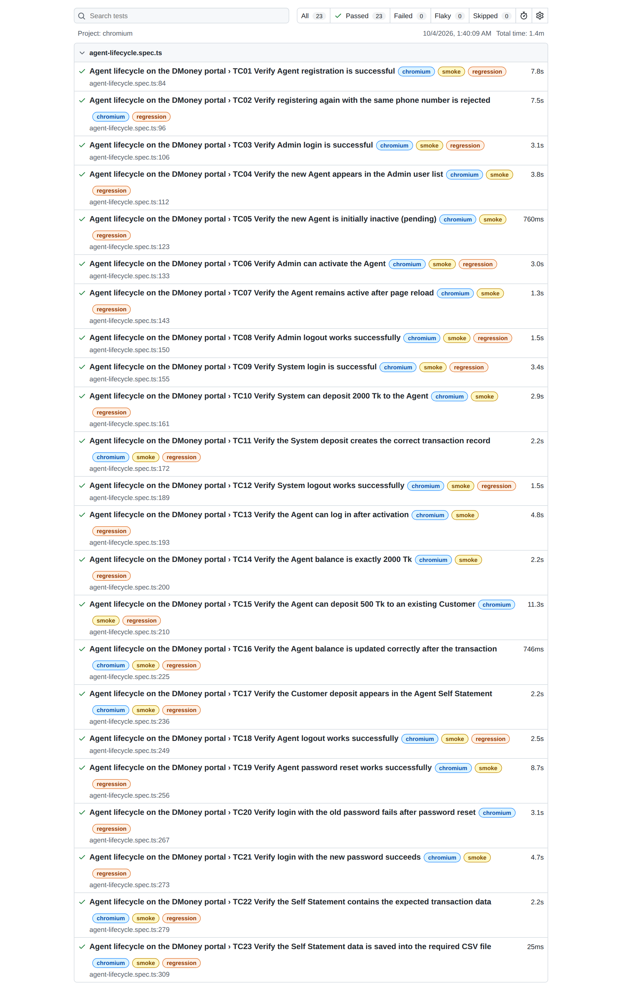
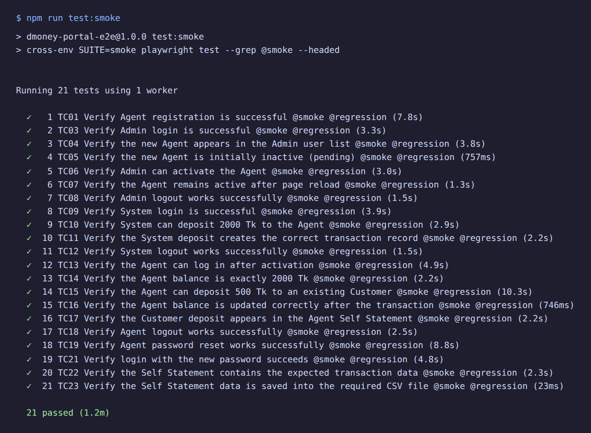
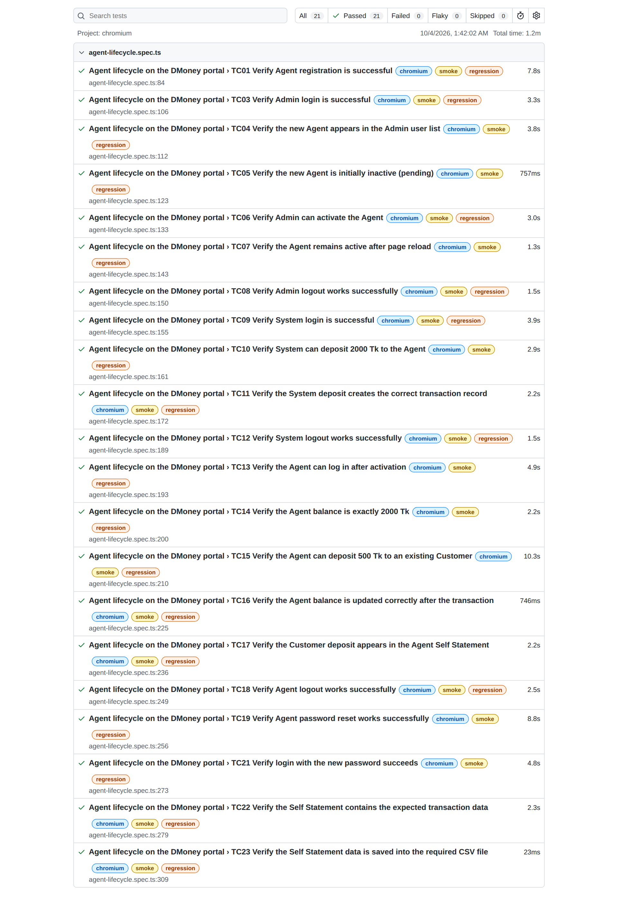

# DMoney Portal — Agent Lifecycle E2E (Playwright)

End-to-end automation of the **Agent journey** on the [DMoney QA Practice Portal](https://dmoneyportal.roadtocareer.net):
register an Agent, activate it as Admin, fund it as System, move money to a Customer, reset the password and export
the Self Statement to CSV.

| | |
|---|---|
| Framework | Playwright Test 1.63 + TypeScript |
| Pattern | Page Object Model, one ordered (serial) journey, one continuous video |
| Suites | **Regression** (23 tests) and **Smoke** (21 positive tests) |
| Latest result | Regression **23 / 23 passed** · Smoke **21 / 21 passed** (headed Chromium) |

## Contents

1. [Test results](#test-results)
2. [The journey](#the-journey)
3. [Requirement coverage](#requirement-coverage)
4. [Smoke vs regression](#smoke-vs-regression)
5. [Getting started](#getting-started)
6. [Project structure](#project-structure)
7. [Design notes and portal behaviour](#design-notes-and-portal-behaviour)
8. [Self Statement CSV](#self-statement-csv)

---

## Test results

Both suites were run **headed** (`--headed`, 700 ms slow-motion so the video is followable) against the live portal.

### Regression Test Result — 23 / 23 passed

Full journey including the two negative checks. [▶ Watch the full headed run (mp4, 1m 22s)](docs/videos/regression-full-run.mp4)

**Console output**



**Playwright HTML report**



### SmokeTest Result — 21 / 21 passed

Positive cases only (`@smoke`). [▶ Watch the smoke run (mp4)](docs/videos/smoke-run.mp4)

**Console output**



**Playwright HTML report**



---

## The journey

```
Register Agent ──► Admin login ──► find Agent (pending) ──► activate ──► reload (still active) ──► Admin logout
      │
      ▼
System login ──► deposit 2000 Tk to Agent ──► verify transaction record ──► System logout
      │
      ▼
Agent login (password + OTP) ──► balance = 2000 ──► deposit 500 Tk to a Customer ──► balance = 1512.50
      │                                                       ▼
      │                                          deposit shown in Self Statement ──► Agent logout
      ▼
Forgot password ──► reset ──► old password rejected ──► login with new password ──► Self Statement ──► CSV
```

Every step is its own test, so the report shows exactly where a run stops. Tests share state (the generated Agent,
transaction ids) and run in order; if one fails, the rest are skipped rather than failing for the wrong reason.

---

## Requirement coverage

| # | Required validation | Test |
|---|---|---|
| 1 | Agent registration is successful | TC01 |
| 2 | New Agent is initially inactive | TC05 |
| 3 | Admin login is successful | TC03 |
| 4 | New Agent appears in the Admin user list | TC04 |
| 5 | Admin can activate the Agent | TC06 |
| 6 | Agent remains active after page reload | TC07 |
| 7 | System login is successful | TC09 |
| 8 | System can deposit 2000 Tk to the Agent | TC10 |
| 9 | System deposit creates the correct transaction record | TC11 |
| 10 | Agent can log in after activation | TC13 |
| 11 | Agent balance is exactly 2000 Tk | TC14 |
| 12 | Agent can deposit 500 Tk to an existing Customer | TC15 |
| 13 | Agent balance is updated correctly after the transaction | TC16 |
| 14 | Customer deposit appears in the Agent's Self Statement | TC17 |
| 15 | Agent logout works | TC18 (Admin: TC08, System: TC12) |
| 16 | Agent password reset works | TC19 |
| 17 | Login with the old password fails after reset | TC20 |
| 18 | Login with the new password succeeds | TC21 |
| 19 | Self Statement contains the expected transaction data | TC22 |
| 20 | Self Statement data is saved to the required CSV file | TC23 |
| + | *Extra:* registering again with a used phone number is rejected | TC02 |

---

## Smoke vs regression

Each test carries tags: positive tests are `@smoke @regression`, negative tests are `@regression` only.

| Suite | Command | Tests | Contains |
|---|---|---|---|
| Regression | `npm run test:regression` | 23 | everything |
| Smoke | `npm run test:smoke` | 21 | positive cases only |

The two tests excluded from smoke are the negative ones: **TC02** (duplicate phone rejected) and **TC20** (old
password rejected). The journey does not depend on either, so smoke still runs end to end.

---

## Getting started

Requires Node.js 20+.

```bash
npm install
npx playwright install chromium
```

| Command | What it does |
|---|---|
| `npm run test:regression` | Full suite, **headed**, HTML report in `playwright-report/regression` |
| `npm run test:smoke` | Smoke suite, **headed**, HTML report in `playwright-report/smoke` |
| `npm run test:regression:headless` / `test:smoke:headless` | Same, headless |
| `npm run report:regression` / `report:smoke` | Open the matching HTML report |
| `npm run typecheck` | TypeScript check |

Optional environment variables:

| Variable | Default | Purpose |
|---|---|---|
| `SLOW_MO` | `250` | Milliseconds between actions (higher = easier to follow on video) |
| `CUSTOMER_PHONE` | auto-picked | Pin the Customer used for the 500 Tk deposit |

Each run registers a brand-new Agent with a unique email, phone and NID, so runs never collide.

**Video:** a run records one continuous `.webm` for the whole journey and attaches it to the HTML report. To make an
mp4 for the README: `ffmpeg -i full-journey.webm -c:v libx264 -pix_fmt yuv420p docs/videos/<name>.mp4`.

**README screenshots:** `node scripts/capture-evidence.js <smoke|regression> <console-output.txt>` renders the console
output and the HTML report to `docs/screenshots/`.

---

## Project structure

```
.
├── tests/agent-lifecycle.spec.ts   # the 23-step journey, tagged @smoke / @regression
├── pages/                          # page objects
│   ├── app-shell.ts                #   header: logout, navigation
│   ├── login-page.ts               #   login, OTP step, forgot-password link
│   ├── register-page.ts
│   ├── admin-users-page.ts         #   search, view, activate
│   ├── cash-in-page.ts             #   deposits (System → Agent, Agent → Customer)
│   ├── forgot-reset-pages.ts
│   ├── profile-page.ts
│   └── self-statement-page.ts      #   date range, table read with pagination
├── utils/
│   ├── test-data.ts                # credentials, amounts, unique Agent factory
│   ├── portal-api.ts               # Admin-API helpers: OTP, reset token, customer lookup
│   └── format.ts                   # local dates, CSV write/parse
├── scripts/capture-evidence.js     # README screenshots
├── docs/                           # committed evidence: screenshots, videos, sample CSV
├── output/                         # generated CSV (git-ignored)
└── playwright.config.ts
```

Generated folders — `node_modules/`, `test-results/`, `playwright-report/`, `output/*.csv`, `.playwright-mcp/`, `.env*`
— are listed in `.gitignore`. Evidence meant for review lives under `docs/`.

---

## Design notes and portal behaviour

Things the automation has to work around, and why:

- **OTP login for Agents.** Admin and System log straight in, but an Agent must enter a 4-digit OTP that the portal
  e-mails to a Gmail address. A test cannot read that inbox, so `utils/portal-api.ts` reads the OTP (and the
  password-reset token) from the Admin user-lookup API, which exposes them on the user record. The OTP form and the
  reset form are still driven through the browser; only the "read the e-mail" step is replaced.
  *(Worth reporting as a finding: that endpoint returns `otp`, `reset_token` and password hashes.)*
- **Customer wallet cap.** A Customer wallet is capped at about 10,000 Tk and deposits above the remaining room are
  rejected (`Limit exceeded. You can deposit a maximum of 42.80 tk…`). The seeded Customer fills up on a shared
  environment, so the test looks up an active Customer with at least 5,000 Tk of headroom at run time.
- **Agent commission.** A 500 Tk cash-in earns the Agent 2.5 % (12.50 Tk), so the balance after the deposit is
  `2000 − 500 + 12.50 = 1512.50`, and that is what TC16 asserts.
- **Self Statement default date is UTC "today".** For testers east of UTC the default range hides today's
  transactions until late in the day (seen from Asia/Dhaka). Tests always set the date range explicitly.
- **Some "errors" are HTTP 208** (for example a duplicate registration), so tests check the message as well as the status.
- **Shared environment.** The portal is shared with other learners. Tests only create and modify their own Agent and
  never touch other users.

---

## Self Statement CSV

TC23 reads every page of the Agent's Self Statement table (all columns, all rows) and writes it to
`output/self_statement_<YYYY-MM-DD>.csv`, using the local date, for example `self_statement_2026-10-04.csv`. The test
reads the file back and checks the file name, the header row and that every row matches the table.

A sample from the recorded run is committed at [docs/sample/self_statement_2026-10-04.csv](docs/sample/self_statement_2026-10-04.csv):

```csv
Transaction ID,Sender Account,Receiver Account,Type,Debit,Credit,Balance,Date
TXN…,SYSTEM,<agent phone>,Top-up from SYSTEM,-,2000.00,2000.00,"04/10/2026, 01:40:…"
TXN…,<agent phone>,<customer phone>,Deposit Commission,500.00,12.50,1512.50,"04/10/2026, 01:40:…"
```
